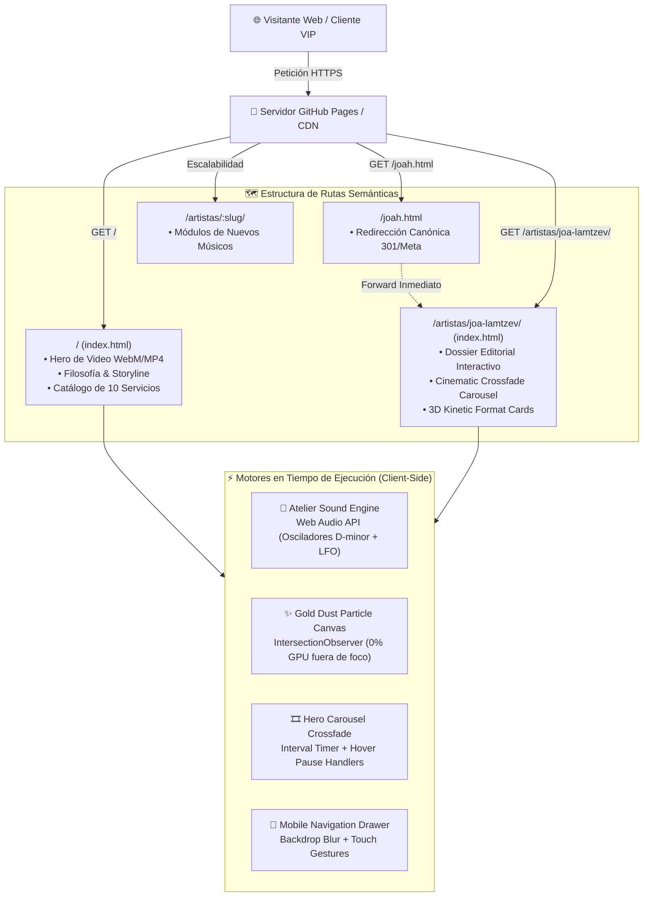
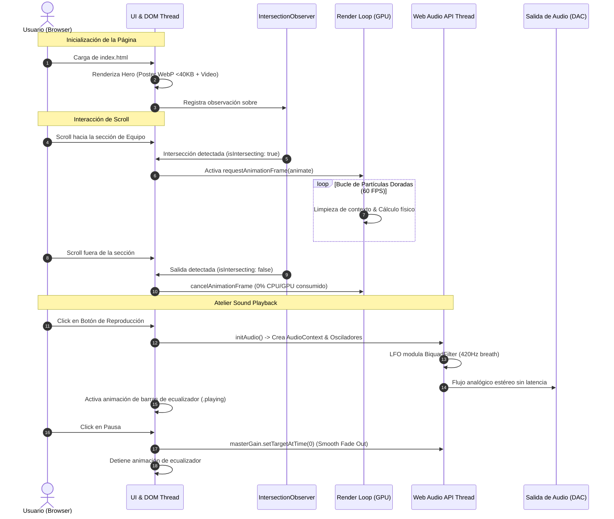

<div align="center">

# 🏛️ RITE OF PASSAGE
### *Atelier Sonoro & Eventos Bespoke de Vanguardia*

[](#)
[](#)
[](#)
[](#)
[](#)
[](#)

<p align="center">
  <b>Plataforma web de alto rendimiento y arquitectura orientada a recursos para curaduría acústica, hardware de primer nivel y espectáculos inmersivos exclusivos.</b>
</p>

[🌐 Explorar Sitio en Vivo](https://leonardolazza.github.io/rite_of_passage/) · [🎷 Minisite Joa Lamtzev](https://leonardolazza.github.io/rite_of_passage/artistas/joa-lamtzev/) · [📋 Roadmap Técnico](#-roadmap-de-mejoras--checklist)

---

</div>

## 📌 Resumen Ejecutivo & Capacidades

**Rite of Passage** trasciende el concepto tradicional de entretenimiento corporativo y social: concibe cada velada como un **rito de pasaje** y una experiencia acústica a medida (*bespoke*). La dirección artística entrelaza la sofisticación clásica del saxofón con la potencia de la música electrónica contemporánea y el diseño escenográfico de vanguardia.

### 🌟 Capacidades Técnicas & Arquitectónicas
- **Arquitectura de URLs Orientada a Recursos:** Rutas semánticas y canónicas (`/artistas/<slug>/`), permitiendo que cada artista o músico cuente con un minisite y dossier independiente y desacoplado.
- **Reproductor "Atelier Sound" Zero-Payload:** Motor sonoro ambiental sintetizado en tiempo real mediante la **Web Audio API** nativa (0 KB de descargas adicionales), con ecualizador animado sincronizado.
- **Optimización Extrema de Medios (92% de Ahorro):**
  - Fotograma WebP de ultra alta fidelidad (<40 KB) sustituyendo el póster GIF previo de 27.8 MB.
  - 29 fotografías DSLR recomprimidas mediante remuestreo Lanczos (reducción de 128.6 MB a 10.1 MB).
  - Video hero recodificado con **FFmpeg** a 1080p 30fps y CRF 28 con contenedor WebM y MP4 silenciado.
- **Eliminación Total de Cumulative Layout Shift (CLS):** Atributos explícitos `width`, `height`, `loading="lazy"` y `decoding="async"`.
- **Ejecución Asíncrona & Observer de Canvas:** Partículas doradas de atelier (`teamCanvas`) reguladas por `IntersectionObserver`, pausando el consumo de GPU al salir del viewport.
- **Microdatos Semánticos:** Esquemas estructurados **Schema.org** (`MusicGroup`, `Person`, `MusicArtist`) y tarjetas sociales Open Graph / Twitter Cards completas.
- **Despliegue Continuo (CI/CD):** Pipeline nativo mediante GitHub Actions para publicación instantánea en GitHub Pages.

---

## 🏛️ Arquitectura del Sistema

### 1. Flujo de Datos y Enrutamiento Orientado a Recursos



---

### 2. Diagrama de Concurrencia y Ciclo de Eventos



---

## 📡 Especificación de Recursos & Microdatos

### Mapa de Recursos Canónicos

| Recurso | Método / Tipo | URL Relativa | Propósito |
| :--- | :--- | :--- | :--- |
| **Atelier Home** | `GET` | `/` | Portal maestro de la productora, servicios y filosofía |
| **Dossier Joa Lamtzev** | `GET` | `/artistas/joa-lamtzev/` | Minisite del saxofonista y DJ residente |
| **Redirect Legacy** | `301 / Meta` | `/joah.html` | Redirección sin fricción a `/artistas/joa-lamtzev/` |
| **Atelier Sound** | Web Audio | Flotante (`#atelierAudioBar`) | Sintetizador analógico virtual en vivo |
| **WhatsApp Direct** | Protocolo URI | `wa.me/5492914074772` | Canal directo de cotización para eventos bespoke |

### Microdatos Schema.org Inyectados (JSON-LD)
- **`index.html`:** Entidad `MusicGroup` que vincula razón social, teléfono, correo oficial y lista de miembros (`member: [{ @type: "Person", name: "Joa Lamtzev" }]`).
- **`artistas/joa-lamtzev/index.html`:** Entidad `Person` con rol `MusicArtist`, especialidad en saxofón, DJ sets y enlace a su cuenta verificada de Instagram.

---

## 🛠️ Guía de Ejecución y Despliegue Local (Runbook)

### 1. Clonación del Repositorio
```bash
git clone git@github.com:leonardolazza/rite_of_passage.git
cd rite_of_passage
```

### 2. Ejecución de un Servidor Local
Para verificar rutas orientadas a recursos sin restricciones de protocolo `file://`:
```bash
# Con Python 3
python -m http.server 8080

# O con Node.js / npx
npx serve .
```
Acceder en el navegador a: `http://localhost:8080/`

### 3. Despliegue Automático en GitHub Pages
El repositorio incluye el workflow oficial `.github/workflows/deploy.yml`. Para habilitarlo:
1. En GitHub, ingresar a **Settings** -> **Pages**.
2. En **Build and deployment** -> **Source**, seleccionar **GitHub Actions**.
3. Mergear la rama de trabajo a `main`:
   ```bash
   git checkout main
   git merge feature/improvements-checklist
   git push origin main
   ```
4. El pipeline compilará y publicará el sitio automáticamente en:
   `https://leonardolazza.github.io/rite_of_passage/`

---

## 📋 Roadmap de Mejoras & Checklist

- [x] **Hito 0: Correcciones Críticas & Higiene (P0)**
  - [x] Resolver bug de `goToHeroSlide` y crossfade en el carrusel de Joa.
  - [x] Optimizar canvas de partículas con `IntersectionObserver`.
  - [x] Purgar >113 MB de archivos duplicados (`imagenes/` y `.mkv`).
- [x] **Hito 1: Optimización de Medios (P0)**
  - [x] Sustituir póster GIF de 27.8 MB por WebP nativo (<40 KB).
  - [x] Recomprimir fotografías DSLR (ahorro de 118 MB en assets).
  - [x] Recodificar video hero con FFmpeg (WebM + MP4 sin audio nulo).
  - [x] Añadir dimensiones explícitas y lazy loading universal.
- [x] **Hito 2: Arquitectura de Recursos (/artistas/:slug/) (P1)**
  - [x] Reestructurar minisite a `/artistas/joa-lamtzev/`.
  - [x] Incorporar reproductor minimalista flotante *Atelier Sound*.
  - [x] Añadir menú móvil editorial responsive y botón flotante de WhatsApp.
- [x] **Hito 3: Dominio, Schema.org & SEO (P1)**
  - [x] Configurar Open Graph, Twitter Cards, `sitemap.xml` y `robots.txt`.
  - [x] Inyectar microdatos JSON-LD (`MusicGroup` y `Person`).
- [x] **Hito 4: Automatización CI/CD a GitHub Pages**
  - [x] Workflow oficial de GitHub Actions para despliegue continuo.
- [x] **Hito 5: Documentación de Estándar de Producción (docs)**
  - [x] README de producción según especificación `/conventional-commits-readme`.

---

<div align="center">
  <sub>Desarrollado y mantenido con estándares de ingeniería de software para <b>Rite of Passage Atelier</b>.</sub>
</div>
