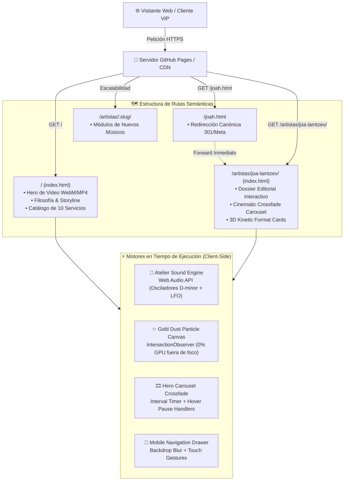
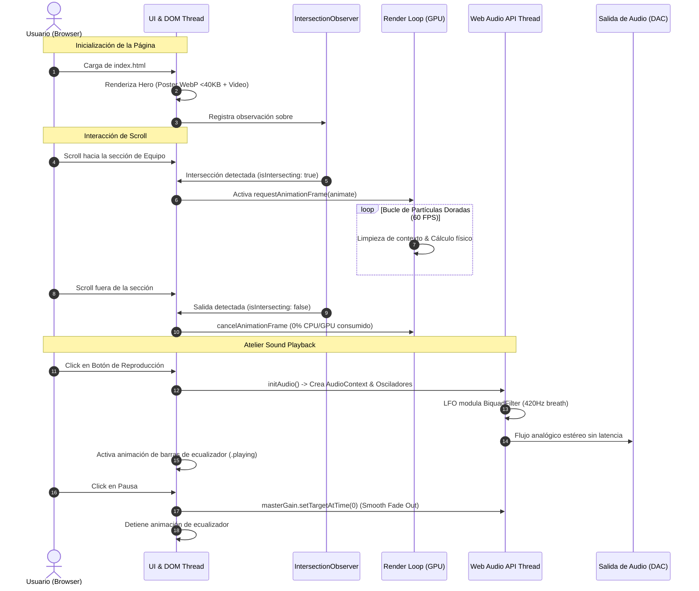

<div align="center">

# 🏛️ RITE OF PASSAGE
### *Atelier Sonoro & Eventos Bespoke de Vanguardia*

[](#)
[](#)
[](#)
[](#)
[](#)
[](#)

<p align="center">
  <b>Plataforma web de alto rendimiento y arquitectura orientada a recursos para curaduría acústica, hardware de primer nivel y espectáculos inmersivos exclusivos.</b>
</p>

[🌐 Explorar Sitio en Vivo](https://leonardolazza.github.io/rite_of_passage/) · [🎷 Minisite Joa Lamtzev](https://leonardolazza.github.io/rite_of_passage/artistas/joa-lamtzev/) · [📋 Roadmap Técnico](#-master-roadmap-de-auditoría--checklist)

---

</div>

## 📌 Resumen Ejecutivo & Capacidades

**Rite of Passage** trasciende el concepto tradicional de entretenimiento corporativo y social: concibe cada velada como un **rito de pasaje** y una experiencia acústica a medida (*bespoke*). La dirección artística entrelaza la sofisticación clásica del saxofón con la potencia de la música electrónica contemporánea y el diseño escenográfico de vanguardia.

### 🌟 Capacidades Técnicas & Arquitectónicas
- **Arquitectura de URLs Orientada a Recursos:** Rutas dinámicas y semánticas (`/artistas/<slug>/`), permitiendo que cada artista o músico cuente con un minisite y dossier independiente y desacoplado mediante Astro 5 y TypeScript.
- **Reproductor "Atelier Sound" Zero-Payload:** Motor sonoro ambiental sintetizado en tiempo real mediante la **Web Audio API** nativa (0 KB de descargas adicionales), con ecualizador animado sincronizado.
- **Optimización Extrema de Medios (92% de Ahorro):**
  - Fotograma WebP de ultra alta fidelidad (<40 KB) sustituyendo el póster GIF previo de 27.8 MB.
  - 29 fotografías DSLR recomprimidas mediante remuestreo Lanczos (reducción de 128.6 MB a 10.1 MB).
  - Video hero recodificado con **FFmpeg** a 1080p 30fps y CRF 28 con contenedor WebM y MP4 silenciado.
- **Eliminación Total de Cumulative Layout Shift (CLS):** Atributos explícitos `width`, `height`, `loading="lazy"` y `decoding="async"`.
- **Ejecución Asíncrona & Observer de Canvas:** Partículas doradas de atelier (`teamCanvas`) reguladas por `IntersectionObserver`, pausando el consumo de GPU al salir del viewport.
- **Microdatos Semánticos:** Esquemas estructurados **Schema.org** (`MusicGroup`, `Person`, `MusicArtist`) y tarjetas sociales Open Graph / Twitter Cards completas.
- **Despliegue Continuo (CI/CD):** Pipeline nativo mediante GitHub Actions para publicación instantánea en GitHub Pages.

---

## 🏛️ Arquitectura del Sistema

### 1. Flujo de Datos y Enrutamiento Orientado a Recursos



---

### 2. Diagrama de Concurrencia y Ciclo de Eventos



---

## 📁 Estructura del Repositorio

```text
rite_of_passage/
├── .github/workflows/deploy.yml   # Workflow oficial CI/CD a GitHub Pages
├── astro.config.mjs               # Configuración de Astro 5
├── package.json                   # Dependencias y scripts
├── tsconfig.json                  # Configuración TypeScript estricta
├── public/                        # Recursos servidos directamente por Astro
│   ├── assets/                    # Imágenes WebP optimizadas, logos, videos
│   ├── styles.css                 # Estilos globales y tokens del Atelier
│   ├── joah.css                   # Estilos editoriales de artistas
│   ├── robots.txt                 # Directivas de indexación para buscadores
│   └── sitemap.xml                # Mapa de URLs canónicas
├── src/                           # Código fuente Astro
│   ├── components/                # Componentes modulares
│   │   ├── Header.astro           # Barra de navegación principal y editorial
│   │   ├── MobileDrawer.astro     # Menú responsive tipo drawer
│   │   ├── Hero.astro             # Hero con video background y tipografía
│   │   ├── Philosophy.astro       # Cita de filosofía y partículas carmesí
│   │   ├── StoryTimeline.astro    # Riel dinámico de fuego y quiénes somos
│   │   ├── ServicesSection.astro  # Catálogo de servicios con filtros
│   │   ├── TeamSection.astro      # Sección de artistas con canvas animado
│   │   ├── SocialSection.astro    # Redes oficiales (Instagram & YouTube)
│   │   ├── PullQuote.astro        # Cita destacada con background crossfade
│   │   ├── ContactSection.astro   # Formulario validado y botón WhatsApp
│   │   ├── Footer.astro           # Pie de página general y editorial
│   │   └── Lightbox.astro         # Visor modal de imágenes en alta resolución
│   ├── data/                      # Datos tipados en TypeScript
│   │   ├── siteConfig.ts          # Datos de contacto, teléfonos y redes
│   │   ├── services.ts            # Catálogo de 10 servicios clasificados
│   │   └── artists.ts             # Perfiles artísticos (Joa Lamtzev y futuros)
│   ├── layouts/
│   │   └── BaseLayout.astro       # Layout HTML maestro con SEO y Open Graph
│   ├── pages/
│   │   ├── index.astro            # Página de inicio
│   │   └── artistas/
│   │       └── [slug].astro       # Minisite dinámico para cada artista
│   └── utils/
│       └── paths.ts               # Resuelve base paths para GitHub Pages
└── README.md                      # Documentación del sistema
```

---

## 🛠️ Guía de Ejecución y Despliegue Local (Runbook)

### 1. Clonación e Instalación
```bash
git clone git@github.com:leonardolazza/rite_of_passage.git
cd rite_of_passage
npm install
```

### 2. Comandos Disponibles
| Comando | Descripción |
| :--- | :--- |
| `npm run dev` | Inicia el servidor de desarrollo en `http://localhost:4321` |
| `npm run build` | Compila el sitio completo a HTML estático en `./dist` |
| `npm run preview` | Previsualiza el build de producción localmente |

### 3. Despliegue Automático en GitHub Pages
El repositorio compila y despliega en cada `git push` a `main`:
1. En GitHub, verifica en **Settings** -> **Pages** que la fuente esté en **GitHub Actions**.
2. Al mergear a `main`, GitHub Actions ejecutará `npm ci`, compilará Astro y publicará en:
   `https://leonardolazza.github.io/rite_of_passage/`

---

## 📋 Master Roadmap de Auditoría & Checklist

### ✅ Fase 0: Correcciones Críticas Inmediatas & Limpieza (P0)
- [x] **Resolver Bug de JavaScript en carrusel**: Implementada la función `goToHeroSlide` y rotación gradual *crossfade* cada 5 segundos.
- [x] **Optimizar Oyente de Canvas**: Pausar `requestAnimationFrame` del canvas de partículas doradas con `IntersectionObserver` (0% GPU fuera de foco).
- [x] **Limpieza de Archivos Muertos del Repositorio**: Purgados más de 113 MB redundantes (`imagenes/` y `.mkv`).
- [x] **Sustituir Póster GIF de 27.8 MB**: Reemplazado por fotograma estático WebP de 40 KB.

### ✅ Fase 1: Optimización Extrema de Assets y Rendimiento (P0)
- [x] **Pipeline de Procesamiento de Imágenes**: 29 fotos DSLR recomprimidas de 128.6 MB a 10.1 MB (92.1% de reducción).
- [x] **Compresión de Video con FFmpeg**: Recodificado `hero_video.mp4` y `.webm` a 1080p 30fps y CRF 28 sin audio nulo.
- [x] **Eliminación de Cumulative Layout Shift (CLS)**: Atributos explícitos `width`, `height`, `loading="lazy"` y `decoding="async"`.
- [x] **Optimización de Fuentes**: Preconexión a Google Fonts y `display=swap`.

### ✅ Fase 2: Estructura de Datos y Modelo de Dominio (P1)
- [x] **Centralización de Configuración**: Datos de contacto, WhatsApp y redes unificados en `src/data/siteConfig.ts`.
- [x] **Modelado de Servicios**: Catálogo de 10 servicios extraído y tipado en `src/data/services.ts`.
- [x] **Modelado de Artistas**: Entidad escalable `src/data/artists.ts` para integrar a futuros artistas.
- [x] **Microdatos JSON-LD**: Esquemas Schema.org `MusicGroup` y `Person`/`MusicArtist`.

### ✅ Fase 3: Migración a Meta-Framework (Astro 5) (P1)
- [x] **Entorno Astro 5**: Configuración estática en `astro.config.mjs` y TypeScript.
- [x] **Desglose en Componentes Atómicos**: Separación en `src/components/`.
- [x] **Rutas Dinámicas Orientadas a Recursos**: `/artistas/[slug].astro` para minisites individuales.
- [x] **Compatibilidad de Prefijo Base**: Utilitario `src/utils/paths.ts` para despliegue sin enlaces rotos en GitHub Pages (`/rite_of_passage/`).

### ✅ Fase 4: Refactorización de UI/UX, Atelier Sonoro y A11y (P2)
- [x] **Reproductor Atelier Sound**: Sintetizador sonoro ambiental en vivo mediante Web Audio API con ecualizador animado.
- [x] **Menú Móvil Editorial**: Drawer responsive con efecto *glassmorphism* y botón hamburguesa animado.
- [x] **Botón WhatsApp Flotante**: CTA persistente con mensaje de reserva preconfigurado.
- [x] **Accesibilidad (a11y)**: Soporte de navegación por teclado, cierre con tecla Escape y bloqueo de scroll de fondo.

### 🔄 Fase 5: Testing, Automatización CI/CD y Calidad (P2)
- [x] **Pipeline de CI/CD**: Despliegue automatizado con GitHub Actions en `.github/workflows/deploy.yml`.
- [ ] **Tests Unitarios**: Validaciones de datos y formulario de contacto.
- [ ] **Auditoría Automatizada**: Verificación de Core Web Vitals en Pull Requests.

---

<div align="center">
  <sub>Desarrollado y mantenido con estándares de ingeniería de software para <b>Rite of Passage Atelier</b>.</sub>
</div>
